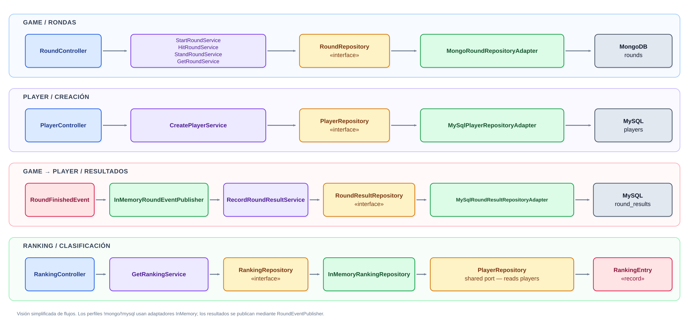
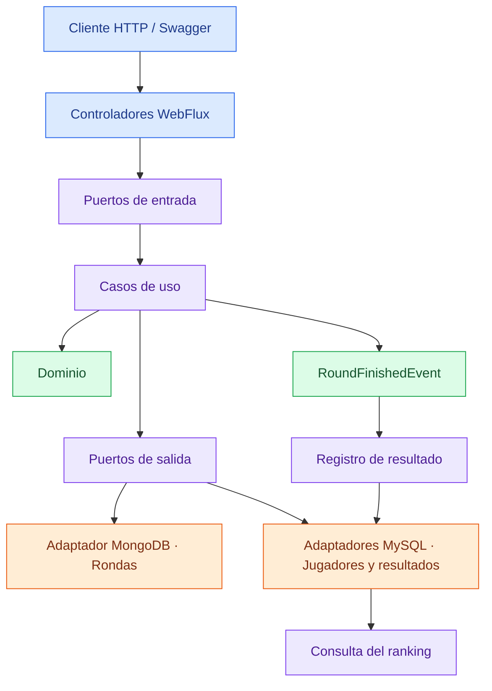
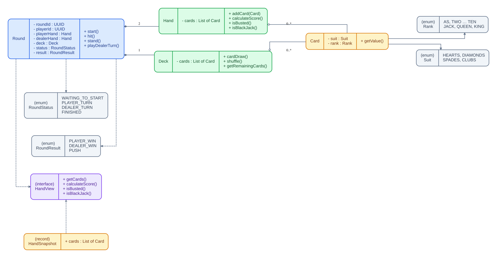

# Blackjack Game — API REST

Backend de un juego de **Blackjack** desarrollado como práctica del **Sprint 5 de la especialización Backend Java (IT Academy)**. Permite registrar jugadores, disputar rondas contra la banca y consultar una clasificación persistente.

El alcance es deliberadamente reducido: **un jugador humano frente al dealer**, sin apuestas, fichas, saldo, mesas ni multijugador. La finalidad es aplicar reglas de dominio, arquitectura hexagonal, programación reactiva, persistencia en dos bases de datos y pruebas automatizadas.

> **Estado:** backend funcional. El frontend React se desarrolla por separado y no forma parte de este repositorio.
>
> **Rama de desarrollo:** [`dev`](https://github.com/Enzo979899/blackjack-game/tree/dev).

## Índice

1. [Reglas implementadas](#reglas-implementadas)
2. [Tecnologías](#tecnologías)
3. [Arquitectura y estructura](#arquitectura-y-estructura)
4. [Modelo de dominio](#modelo-de-dominio)
5. [Persistencia: MongoDB y MySQL](#persistencia-mongodb-y-mysql)
6. [Evento de fin de ronda](#evento-de-fin-de-ronda)
7. [API REST y Swagger](#api-rest-y-swagger)
8. [Ejecución local](#ejecución-local)
9. [Configuración](#configuración)
10. [Pruebas y cobertura](#pruebas-y-cobertura)
11. [Decisiones de diseño y limitaciones](#decisiones-de-diseño-y-limitaciones)

## Reglas implementadas

- Se utiliza una **baraja estándar de 52 cartas**, sin comodines, que se mezcla al comenzar una ronda.
- El reparto inicial es alterno: **jugador → dealer → jugador → dealer**.
- Las cartas numéricas valen su número; J, Q y K valen **10**; el as vale **11 o 1**, según convenga para no superar 21.
- Un **Blackjack natural** es una mano inicial de dos cartas que suma 21. Se resuelve inmediatamente: gana quien lo tenga o hay empate (*push*) si ambos lo tienen.
- El jugador puede pedir carta (**hit**) mientras sea su turno. No se permite pedir con 21 puntos.
- El jugador puede plantarse (**stand**); entonces juega la banca automáticamente.
- El dealer roba mientras su puntuación sea **inferior a 17** y se planta con **17 o más** (incluido el 17 suave).
- Si una mano supera 21, se pasa (*bust*). Si se pasa el jugador, gana la banca; si se pasa el dealer, gana el jugador.
- Si ninguno se pasa, gana quien tenga mayor puntuación; a igual puntuación hay **empate**.
- Mientras la ronda está activa, la API solo muestra **una carta del dealer**. Al finalizar se muestran todas.
- Una ronda terminada no admite nuevas acciones de juego.

Los resultados posibles son `PLAYER_WIN`, `DEALER_WIN` y `PUSH`; los estados son `WAITING_TO_START`, `PLAYER_TURN`, `DEALER_TURN` y `FINISHED`.

## Tecnologías

| Área | Tecnología |
| --- | --- |
| Lenguaje | Java 21 |
| Framework | Spring Boot 4.1.1 |
| API HTTP | Spring WebFlux y Project Reactor (`Mono` / `Flux`) |
| Documentación API | springdoc-openapi WebFlux UI 3.2.0 |
| Persistencia de rondas | MongoDB 8.0 y Spring Data MongoDB Reactive |
| Persistencia de jugadores y resultados | MySQL 8.4, Spring Data R2DBC y `r2dbc-mysql` 1.4.2 |
| Construcción | Maven Wrapper |
| Pruebas | JUnit, Spring Boot Test, WebTestClient, Reactor Test y pruebas de integración |
| Cobertura | JaCoCo 0.8.14 |
| Contenedores | Docker y Docker Compose |

## Arquitectura y estructura

El proyecto combina **arquitectura hexagonal (puertos y adaptadores)**, **Vertical Slice** y **Screaming Architecture**:

- **Hexagonal:** los servicios de aplicación dependen de interfaces (`port/in` y `port/out`), no de MongoDB, MySQL ni HTTP.
- **Vertical Slice:** las funcionalidades se agrupan en los módulos `game`, `player` y `ranking`, en vez de colocar todos los controladores, servicios y repositorios del sistema en carpetas globales.
- **Screaming Architecture:** el árbol de paquetes comunica el problema de negocio (rondas, jugadores y clasificación) antes que las herramientas técnicas.

```text
src/main/java/dev/enzo/blackjack/
├── game/
│   ├── domain/                   # Round, Hand, Deck, Card, estados, resultados y evento
│   ├── application/
│   │   ├── port/in/              # StartRound, HitRound, StandRound, GetRound
│   │   ├── port/out/             # RoundRepository, RoundEventPublisher, DeckFactory
│   │   └── usecase/              # Implementaciones de los casos de uso
│   └── infrastructure/
│       ├── in/web/              # API de rondas, DTO y manejo de excepciones
│       ├── persistence/mongo/   # Adaptador y mapeo MongoDB
│       ├── factory/              # Creación de barajas
│       └── fake/                 # Adaptadores en memoria
├── player/
│   ├── domain/                   # Player y estadísticas
│   ├── application/              # Crear jugador y registrar resultado
│   └── infrastructure/           # API, MySQL y adaptadores en memoria
├── ranking/
│   ├── application/              # Consulta y ordenación de la clasificación
│   └── infrastructure/           # API y adaptador de consulta
└── shared/
    ├── configuration/            # Composición de servicios y adaptadores
    └── infrastructure/in/web/    # Validación HTTP compartida
```
### Diagrama de arquitectura

El siguiente diagrama representa la organización del backend
siguiendo arquitectura hexagonal, Vertical Slice y Screaming Architecture.



**Recorrido simplificado de una petición:**



Los adaptadores en memoria permiten ejercitar la lógica sin utilizar bases de datos; los adaptadores reales se seleccionan mediante perfiles de Spring.

## Modelo de dominio

La entidad central del juego es **`Round`**, el agregado que representa una ronda y hace cumplir sus invariantes. Sustituye a una entidad `Game` persistente: para este alcance **no existe una partida superior que agrupe rondas**.

| Elemento | Responsabilidad |
| --- | --- |
| `Round` | Identidad (`roundId`), referencia al jugador (`playerId`), manos, baraja restante, estado y resultado; operaciones `start`, `hit`, `stand` y `playDealerTurn`. |
| `Hand` | Cartas de una mano, cálculo de puntuación, Blackjack natural y comprobación de *bust*. |
| `Card` | Carta definida por `Rank` y `Suit`. |
| `Deck` | Baraja, mezcla y extracción de cartas. |
| `HandView` / `HandSnapshot` | Vista de solo lectura de una mano; evita devolver la mano mutable interna de `Round`. |
| `Player` | Identidad, nombre y contadores `wins`, `losses`, `draws`. |
| `RankingEntry` | Proyección de datos para consultar la clasificación. |
| `RoundFinishedEvent` | Datos inmutables del resultado de una ronda terminada. |

`Round` almacena el **UUID del jugador**, no una referencia a un objeto `Player`. Esto evita acoplar los agregados de juego y jugadores. La reconstitución desde MongoDB se realiza con `Round.restore(...)`, que valida la coherencia entre el estado y el resultado.

Las acciones no permitidas por el estado de la ronda lanzan `InvalidRoundStateException`. La clasificación se ordena por **más victorias**, después **menos derrotas** y finalmente **nombre e identificador** para desempatar.

### Diagrama de clases del dominio

El siguiente diagrama muestra las principales clases del dominio,
sus responsabilidades y las relaciones entre ellas.



## Persistencia: MongoDB y MySQL

Se han elegido dos motores para practicar modelos de persistencia distintos con responsabilidades separadas:

**MongoDB — estado de las rondas**

- Almacena cada `Round` como documento, incluyendo identificadores, estado, resultado, cartas de ambas manos y baraja restante.
- La estructura de una ronda encaja en un documento agregado: sus cartas y su evolución se recuperan conjuntamente.
- Se utiliza un adaptador `MongoRoundRepositoryAdapter` y un mapper para traducir entre dominio y documento.

**MySQL — jugadores, estadísticas y resultados**

- `players`: `id`, `name`, `wins`, `losses`, `draws`.
- `round_results`: `round_id`, `player_id`, `result`.
- La estructura relacional permite asociar resultados a jugadores y mantener el histórico de rondas contabilizadas.
- El `round_id` es clave primaria de `round_results`: un mismo resultado no se contabiliza dos veces.
- El adaptador utiliza una operación transaccional para insertar el resultado y actualizar el contador correspondiente del jugador.

El **ranking** es una consulta sobre los datos de `Player` almacenados en MySQL: no se mantiene una tercera base de datos ni una entidad `Statistics` separada. `ranking` sigue siendo un módulo independiente por responsabilidad funcional.

## Evento de fin de ronda

Cuando una ronda termina (por Blackjack natural, *bust* o resolución tras `stand`), el caso de uso:

1. Actualiza y **guarda la ronda** mediante `RoundRepository`.
2. Construye `RoundFinishedEvent(roundId, playerId, result)`.
3. Publica el evento a través de `RoundEventPublisher`.
4. El adaptador `InMemoryRoundEventPublisher` delega en `RecordRoundResultUseCase`.
5. El repositorio de resultados registra el resultado **solo si ese `roundId` no había sido procesado** y actualiza las estadísticas del jugador.

Es una **separación mediante evento y puertos**, pero **no un broker de mensajería**: la implementación actual invoca el consumidor dentro del flujo reactivo de la aplicación. No existe *outbox* transaccional ni transacción distribuida entre MongoDB y MySQL. Si MongoDB confirma el guardado y después falla el registro en MySQL, puede haber una discrepancia temporal; la deduplicación protege ante reintentos, pero no sustituye una estrategia completa de entrega garantizada.

## API REST y Swagger

Con el backend iniciado:

- **Swagger UI:** <http://localhost:8080/swagger-ui.html> (también puede redirigir a `/swagger-ui/index.html`).
- **Especificación OpenAPI:** <http://localhost:8080/v3/api-docs>.

| Método | Endpoint | Función |
| --- | --- | --- |
| `POST` | `/api/players` | Crear un jugador |
| `POST` | `/api/rounds` | Iniciar una ronda para un jugador existente |
| `GET` | `/api/rounds/{roundId}` | Consultar estado, cartas visibles y resultado |
| `POST` | `/api/rounds/{roundId}/hit` | Pedir carta |
| `POST` | `/api/rounds/{roundId}/stand` | Plantarse y resolver el turno del dealer |
| `GET` | `/api/ranking` | Consultar la clasificación |

Ejemplos de cuerpos JSON:

```json
{"name": "Enzo"}
```

```json
{"playerId": "UUID_DEL_JUGADOR"}
```

En la API, la creación devuelve **HTTP 201**; las acciones `hit` y `stand`, **HTTP 204**. Se usan **HTTP 400** para validaciones, **404** para rondas o jugadores inexistentes y **409** para acciones incompatibles con el estado de una ronda. El formato de error utilizado por los manejadores es `{"error":"mensaje"}`.

> `POST /api/rounds` devuelve el UUID de la nueva ronda. Guárdalo para consultar su estado y jugarla. La ronda puede finalizar inmediatamente por Blackjack natural.

## Ejecución local

### Requisitos

- Git y Docker Desktop (o Docker Engine con Compose).
- Para iniciar Java fuera de Docker: **JDK 21**. No es necesario instalar Maven, ya que se incluye Maven Wrapper.
- Puertos locales libres: **8080** (API), **27017** (MongoDB) y **3307** (MySQL).

### 1. Clonar el proyecto

**Windows — PowerShell**

```powershell
git clone https://github.com/Enzo979899/blackjack-game.git
cd blackjack-game
git switch dev
```

**macOS — Terminal**

```bash
git clone https://github.com/Enzo979899/blackjack-game.git
cd blackjack-game
git switch dev
```

### Opción A. Todo con Docker Compose (recomendada)

Los comandos son idénticos en PowerShell y en Terminal:

```bash
docker compose up -d --build
docker compose ps
docker compose logs -f backend
```

La API queda accesible en <http://localhost:8080>. Para detener y eliminar los contenedores, **conservando los datos**:

```bash
docker compose down
```

Para volver a iniciar:

```bash
docker compose up -d
```

> `docker compose down -v` **borra los volúmenes persistentes**, incluidos los datos de jugadores y rondas. Úsalo únicamente si quieres reiniciar las bases de datos.

### Opción B. Bases de datos en Docker y backend desde el IDE / terminal

Arranca únicamente las bases de datos (mismo comando en ambos sistemas):

```bash
docker compose up -d mongodb mysql
```

**Windows — PowerShell**

```powershell
.\mvnw.cmd spring-boot:run
```

**macOS — Terminal**

```bash
./mvnw spring-boot:run
```

También puedes ejecutar `BlackjackGameApplication` desde IntelliJ IDEA con Java 21. El perfil predeterminado es `mongo,mysql`.

**Importante:** si arrancaste anteriormente el backend mediante Compose, detén **el servicio** `backend` para liberar el puerto 8080 antes de ejecutarlo localmente:

```bash
docker compose stop backend
```

### Opción C. Modo en memoria (sin bases de datos)

Adecuado para desarrollo y comprobaciones rápidas. Los datos no se conservan después de detener la aplicación.

**Windows — PowerShell**

```powershell
.\mvnw.cmd spring-boot:run "-Dspring-boot.run.arguments=--spring.profiles.active=memory"
```

**macOS — Terminal**

```bash
./mvnw spring-boot:run -Dspring-boot.run.arguments=--spring.profiles.active=memory
```

## Configuración

Los archivos están en `src/main/resources/`:

| Archivo | Finalidad |
| --- | --- |
| `application.yaml` | Configuración general y activación predeterminada de `mongo,mysql`. |
| `application-mongo.yaml` | MongoDB local: `mongodb://localhost:27017/blackjack`. |
| `application-mysql.yaml` | MySQL local por R2DBC: `r2dbc:mysql://localhost:3307/blackjack`. |
| `application-memory.yaml` | Exclusión de autoconfiguraciones de las bases de datos para trabajar en memoria. |
| `compose.yaml` | Backend y bases de datos, puertos, variables, volúmenes y comprobaciones de salud. |

**Configuración de desarrollo incluida:**

- MongoDB: contenedor `blackjack-mongodb`, puerto host `27017`, base `blackjack`.
- MySQL: contenedor `blackjack-mysql`, puerto host `3307` (puerto interno `3306`), base `blackjack`, usuario `blackjack` y contraseña de desarrollo `blackjackpass`.
- Dentro de Docker, el backend se conecta por los nombres de servicio `mongodb` y `mysql`, no por `localhost`. Las URLs de conexión se inyectan por variables de entorno desde `compose.yaml`.
- El esquema de MySQL y la base `blackjack_test` se crean con los scripts de `docker/mysql/init/` **en la primera inicialización de un volumen nuevo**.

> Las credenciales del Compose son **solo para entorno local de aprendizaje**. No deben reutilizarse en despliegues públicos. Si cambias los scripts SQL después de crear el volumen MySQL, no se vuelven a ejecutar automáticamente.

## Pruebas y cobertura

El repositorio incluye pruebas de dominio, casos de uso, adaptadores, controladores, flujos de integración y arranque de Spring Boot.

**Antes de ejecutar la batería completa**, levanta las bases de datos de prueba; algunos tests de integración conectan explícitamente a `localhost:27017/blackjack_test` y `localhost:3307/blackjack_test`.

```bash
docker compose up -d mongodb mysql
```

**Windows — PowerShell**

```powershell
.\mvnw.cmd test
.\mvnw.cmd verify
```

**macOS — Terminal**

```bash
./mvnw test
./mvnw verify
```

- `test` ejecuta las pruebas automatizadas.
- `verify` ejecuta además las comprobaciones configuradas en el ciclo Maven, incluido JaCoCo.
- El informe HTML de cobertura se genera en `target/site/jacoco/index.html` tras `verify`.
- El umbral JaCoCo configurado es del **60 % de cobertura de instrucciones total del proyecto**. Es un mínimo de compilación, no una afirmación sobre la cobertura actualmente conseguida.

## Decisiones de diseño y limitaciones

1. **Una ronda, no una entidad `Game`.** `Round` es el agregado principal y contiene el estado necesario para iniciar, continuar, finalizar y restaurar una ronda.
2. **Hexagonal + módulos de negocio.** `game`, `player` y `ranking` tienen responsabilidades diferenciadas. Los repositorios y publicadores se exponen mediante interfaces para intercambiar implementaciones sin cambiar los casos de uso.
3. **API reactiva.** Los casos de uso y puertos de persistencia trabajan con `Mono` y `Flux`, en consonancia con WebFlux y los adaptadores reactivos.
4. **Protección del dominio.** Las manos se exponen mediante `HandView` / `HandSnapshot`; las reglas de turno y de finalización se validan dentro de `Round`, no en los controladores.
5. **Excepciones con intención.** `InvalidRoundStateException` diferencia un conflicto de juego (HTTP 409) de un fallo inesperado; la validación de peticiones se centraliza en `GlobalValidationExceptionHandler`.
6. **Resultados idempotentes.** La clave única `round_id` impide contar dos veces la misma ronda; la actualización del contador correspondiente se hace en una transacción MySQL.

### Control de calidad y cobertura de pruebas con JaCoCo

Se ha incorporado **JaCoCo 0.8.14** para medir la cobertura de las pruebas automatizadas y establecer un control mínimo de calidad del código.

Se han establecido los siguientes criterios:

- **Cobertura mínima obligatoria del 60 % de las instrucciones** del proyecto.
- Generación automática del informe de cobertura mediante Maven.
- Comprobación del umbral durante la fase `verify`.
- Si la cobertura es inferior al 60 %, Maven marca la compilación como fallida.

Durante el desarrollo se alcanzaron aproximadamente un **98 % de cobertura de instrucciones y un 94 % de ramas**, según la medición realizada en aquel momento.

Esta decisión permite complementar los tests unitarios y de integración con una comprobación automatizada de cobertura. El porcentaje de cobertura no garantiza por sí solo la calidad de las pruebas, pero sirve como indicador adicional.

### Dockerización completa del backend

Inicialmente se utilizó Docker Compose únicamente para gestionar las bases de datos MongoDB y MySQL durante el desarrollo.

Posteriormente se decidió **dockerizar también la aplicación Spring Boot**, permitiendo ejecutar todos los servicios sin necesidad de instalar Java o Maven en el equipo anfitrión.

Esta implementación incorpora:

- **Tres servicios independientes:** backend Spring Boot, MongoDB y MySQL.
- **Dockerfile multietapa:** Maven y Java 21 para compilar la aplicación, y una imagen JRE para ejecutarla.
- **Healthchecks:** comprobaciones de salud de MongoDB y MySQL que permiten a Docker Compose esperar a que ambos servicios estén operativos antes de iniciar el backend.
- **Volúmenes persistentes:** conservación de los datos entre reinicios de los contenedores.
- **Configuración reproducible:** mismo entorno de ejecución en Windows y macOS.

**Justificación:** esta decisión mejora la portabilidad, reduce las diferencias entre entornos de desarrollo y facilita la evaluación del proyecto. Toda la infraestructura necesaria puede iniciarse mediante Docker Compose, sin configurar manualmente las bases de datos.

Las instrucciones y comandos correspondientes se encuentran en la sección **«Ejecución local»**.

